# Guia do Revisor de Vídeos

O Revisor de Vídeos confere as videoaulas editadas antes da entrega: áudio, cortes, textos na tela,
ortografia, tarja com o nome do professor, transições de slide, vinhetas e falas como "errei" ou
"retomando". Ele marca o que precisa de atenção, você olha, comenta e manda as correções para o editor.

Tudo roda no seu computador: **nenhum vídeo, frame ou comentário sai dele**.

**Neste guia**
1. [Baixar e instalar](#1-baixar-e-instalar)
2. [Primeira vez: equipe e vinhetas](#2-primeira-vez-equipe-e-vinhetas)
3. [O essencial: o dia a dia em 5 passos](#3-o-essencial-o-dia-a-dia-em-5-passos)
4. [Fila de pastas](#4-fila-de-pastas)
5. [Tela de revisão: todas as funções](#5-tela-de-revisão-todas-as-funções)
6. [Resumo final: mandar as correções](#6-resumo-final-mandar-as-correções)
7. [Levar a revisão para outro computador](#7-levar-a-revisão-para-outro-computador)
8. [Relatório do mês](#8-relatório-do-mês)
9. [Configurações](#9-configurações)
10. [Atalhos de teclado](#10-atalhos-de-teclado)
11. [Atualizar o app](#11-atualizar-o-app)
12. [Problemas comuns](#12-problemas-comuns)

---

## 1. Baixar e instalar

### Baixar pelo GitHub

O app fica na página **Releases** do GitHub. Não precisa ter conta no GitHub para baixar.

**Links diretos (sempre a versão oficial mais nova):**
- **Mac:** https://github.com/jprodriguesgm/revisor-de-videos/releases/latest/download/Revisor-de-Videos-mac.zip
- **Windows:** https://github.com/jprodriguesgm/revisor-de-videos/releases/latest/download/Revisor-de-Videos-windows.zip

Basta clicar: o download começa sozinho (o arquivo tem de 230 a 370 MB). Guarde esses dois links;
eles não mudam quando sai uma versão nova.

Se preferir ver a página com a lista de versões: https://github.com/jprodriguesgm/revisor-de-videos/releases.
A versão oficial mais nova aparece no topo com a etiqueta verde **Latest**. Role até **Assets** e clique em
`Revisor-de-Videos-mac.zip` ou `Revisor-de-Videos-windows.zip`.

> Versões chamadas **"Montagem N (teste)"**, marcadas como **Pre-release**, são versões de teste que ainda
> não foram liberadas. Use sempre a que tem a etiqueta **Latest** (ou os links diretos acima).

### Mac

Funciona em Mac com chip Apple (M1, M2, M3, M4…), macOS 11 ou mais novo. Para conferir: menu da
maçã → **Sobre este Mac** → a linha **Chip** precisa dizer "Apple". Mac com processador Intel não
funciona.

1. Dê dois cliques no `Revisor-de-Videos-mac.zip`. Aparece o **Revisor de Videos**.
2. Arraste o app para a pasta **Aplicativos do seu usuário** (`~/Applications`; se ela não existir,
   crie) ou para qualquer pasta sua. Não precisa ser a pasta Aplicativos do sistema, que pede
   senha de administrador.
3. **Só na primeira vez de cada versão**: o app não tem assinatura da Apple, então o Mac bloqueia.
   Para liberar, abra o **Terminal** (Spotlight → digite "Terminal") e cole a linha abaixo
   (troque o caminho se você deixou o app em outro lugar):

       xattr -dr com.apple.quarantine ~/Applications/"Revisor de Videos.app"

   Outro jeito (macOS 14 ou mais antigo): botão direito no app → **Abrir** → **Abrir**.
4. Dois cliques no app: a página abre no navegador. O app **não aparece no Dock**; ele vive na
   página. Para fechar, use o botão **Sair** (ou só feche a aba; o app fecha sozinho uns minutos
   depois, se nenhuma análise estiver rodando).
5. Na primeira vez que você escolher uma pasta (disco externo, Mesa, Documentos, Google Drive), o Mac
   pergunta se o Revisor pode acessar. Responda **Permitir**.

### Windows 10/11 (64 bits)

1. Clique com o botão direito no `Revisor-de-Videos-windows.zip` → **Propriedades** → marque
   **Desbloquear** → **OK**. Isso evita um aviso para cada arquivo.
2. Botão direito → **Extrair tudo…** para uma pasta sua, por exemplo `Documentos\Revisor de Videos`.
   Não use "Arquivos de Programas", que pede administrador.
3. Dois cliques em **Revisor de Videos.exe**. Se aparecer "O Windows protegeu o computador":
   **Mais informações** → **Executar assim mesmo** (só na primeira vez).
4. A página abre no navegador. Para fechar, use **Sair** ou feche a aba.

Dica: deixe a página aberta no Chrome, no Safari ou no Edge. Ela funciona como um app normal; pode
até ser salva nos favoritos (o endereço é parecido com `http://127.0.0.1:8765`).

---

## 2. Primeira vez: equipe e vinhetas

Na primeira vez, o app avisa no topo do Início: **"Primeira vez? Cadastre os editores da sua equipe"**.

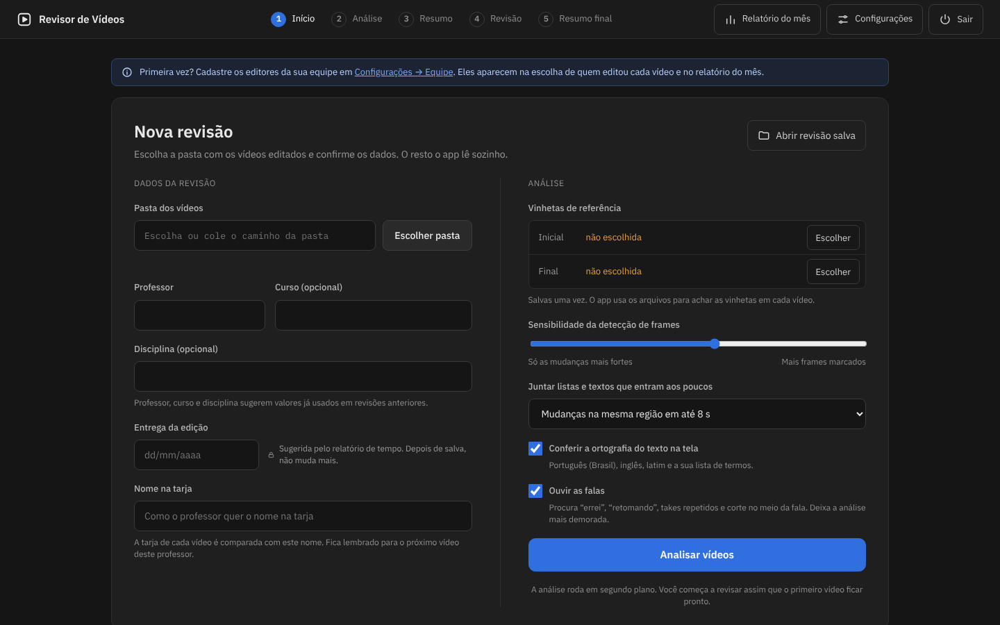

### Cadastrar a equipe

Clique em **Configurações → Equipe** (no aviso, ou no botão **Configurações** no topo e depois em
**Equipe** no menu da esquerda).

1. Digite o nome de cada editor no campo **Adicionar editor** e aperte **Enter** (ou **Adicionar**).
2. Pronto: os nomes aparecem na escolha de quem editou cada vídeo e no relatório do mês.

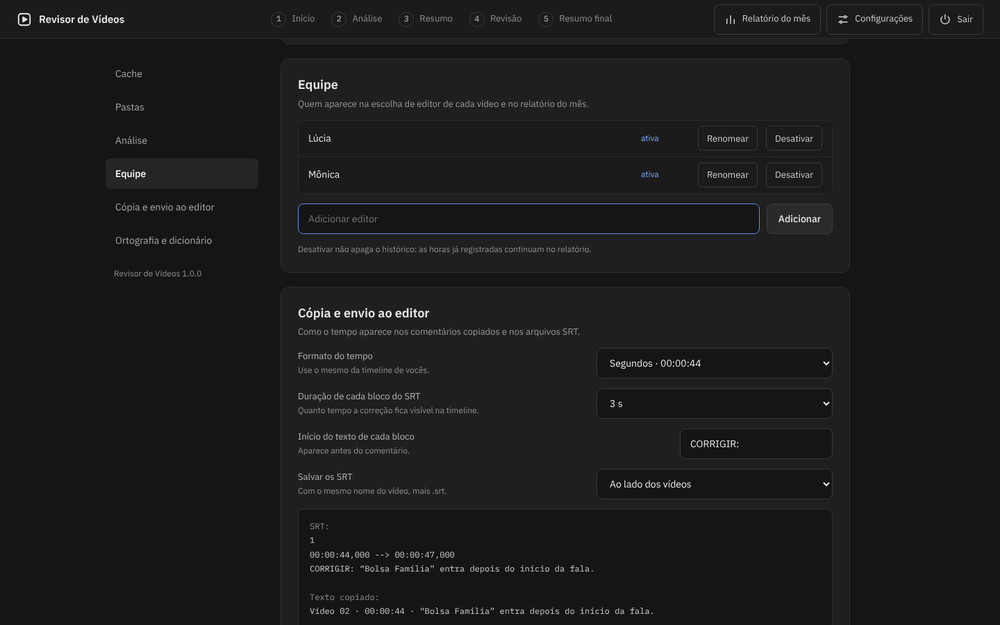

- **Renomear:** troca o nome também nas revisões já salvas (as horas continuam juntas).
- **Desativar:** a pessoa some da lista de escolha, mas o histórico continua no relatório do mês.
  Use quando alguém sai da equipe.

### Escolher as vinhetas (uma vez só)

No **Início**, na coluna **Análise**, escolha os arquivos da **vinheta inicial** e da **vinheta
final** (os mesmos `.mov` usados na edição). O app guarda e usa para achar as vinhetas em cada vídeo:
se estão inteiras, cortadas ou faltando.

---

## 3. O essencial: o dia a dia em 5 passos

### Passo 1 — Início: escolher a pasta

1. **Escolher pasta** → a pasta com os vídeos **editados** (a pasta de saída da edição).
2. O app confere sozinho: quantos vídeos, o tempo total e, se houver, o **relatório de tempo**
   (`Relatorio_tempo_….txt`) com bruto, editado e aproveitamento.
3. Confira **Professor**, **Entrega da edição** e **Nome na tarja** (como o professor quer o nome
   escrito na tarja; o app compara a tarja de cada vídeo com ele). Curso e disciplina são opcionais.
4. **Ouvir as falas:** procura "errei", "retomando", takes repetidos. Deixa a análise mais demorada;
   desligue quando estiver com pressa.
5. Clique em **Analisar vídeos**.

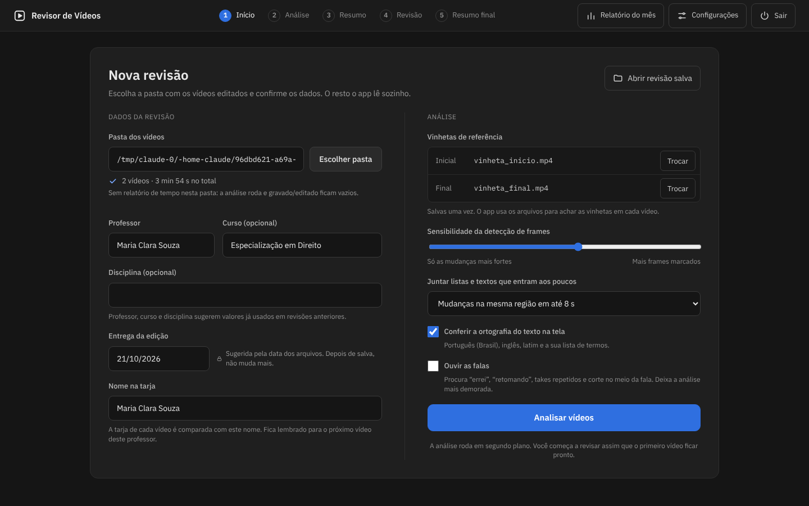

> A **entrega da edição** é a data que conta no relatório do mês. Depois de salva, ela trava.

### Passo 2 — Análise

A análise roda em segundo plano, um vídeo por vez. **Você não precisa esperar tudo**: assim que o
primeiro vídeo fica pronto, clique em **Revisar o vídeo 01 enquanto analisa**.

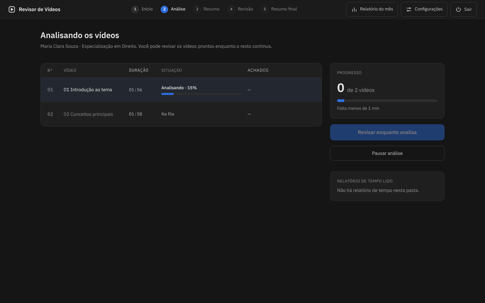

- **Pausar análise** para e continua de onde parou.
- Um vídeo com problema não para os outros.

### Passo 3 — Resumo geral

Mostra o áudio (mínimo, máximo e média de todos os vídeos), os números do relatório de tempo, os
avisos de cada vídeo e o vectorscope médio. Aqui você marca **quem editou cada vídeo** (ou escolhe
um nome e clica em **Aplicar a todos**).

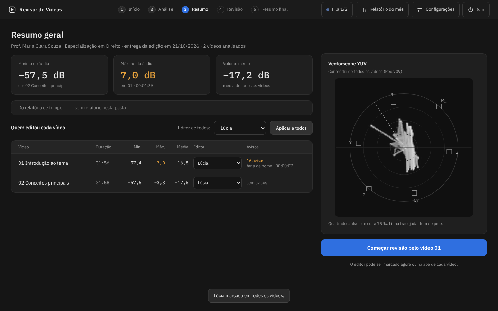

### Passo 4 — Revisão

Uma aba por vídeo. Use **→** para ir de um item marcado para o próximo, olhe o frame e, se algo
precisar ser corrigido, aperte **C** e escreva o comentário (salva sozinho). Detalhes na
[seção 5](#5-tela-de-revisão-todas-as-funções).

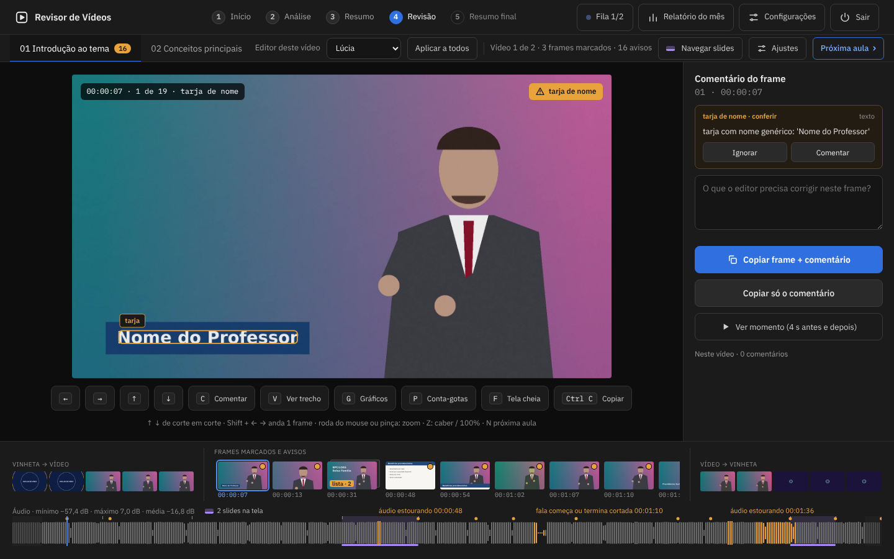

### Passo 5 — Resumo final

Todos os comentários juntos. Copie para mandar ao editor (com ou sem as imagens) ou gere um **SRT**
para ele importar na timeline. Detalhes na [seção 6](#6-resumo-final-mandar-as-correções).

---

## 4. Fila de pastas

Chegou mais de uma pasta para revisar? Coloque todas na fila: o app analisa **uma depois da outra,
sozinho**, enquanto você já revisa a primeira.

1. Com uma análise rodando, volte ao **Início**. O formulário vem vazio e o botão vira
   **Adicionar à fila**.
2. Escolha a próxima pasta, confira os dados e clique em **Adicionar à fila**. Repita para quantas
   pastas quiser.

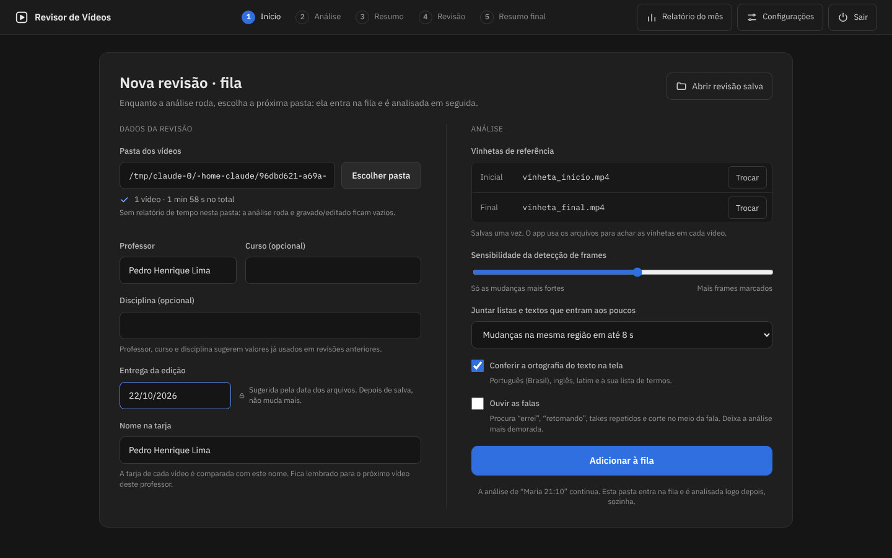

A fila aparece no Início e na tela de Análise:

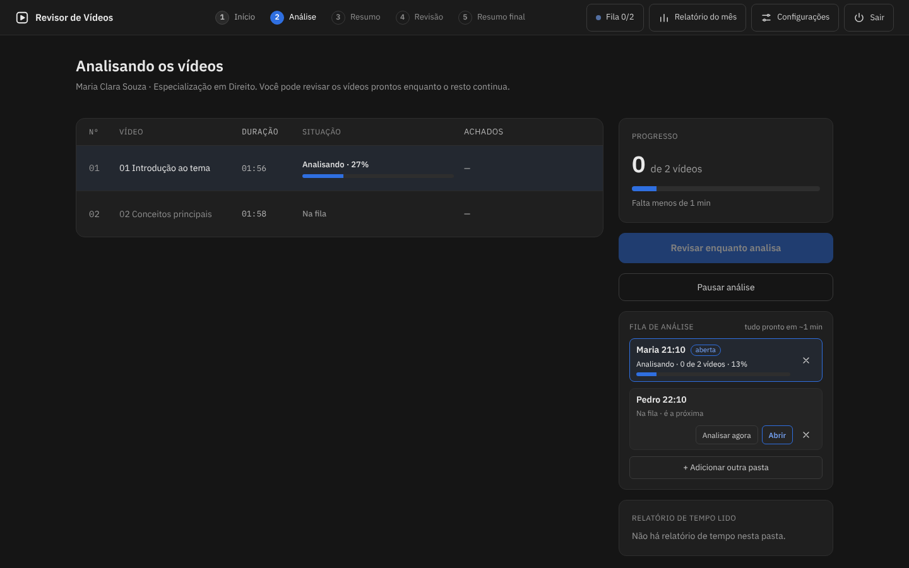

- **Abrir:** abre a revisão daquela pasta. Trocar de pasta **não para** a análise.
- **Analisar agora:** passa a pasta na frente. A que estava analisando volta para a fila logo
  depois (os vídeos que já ficaram prontos não são refeitos).
- **×** tira a pasta da fila. A revisão salva (comentários, editores) não é apagada.
- No topo de todas as telas, **Fila 1/3** mostra quantas pastas já estão prontas.
- **Pausar análise** segura a fila inteira até você continuar.
- Se você fechar o app com pastas na fila, na próxima vez o Início mostra **Continuar a fila**.

Na última aula de uma pasta, o botão **Próxima pasta ›** (no canto de cima, à direita) abre a
próxima pasta da fila.

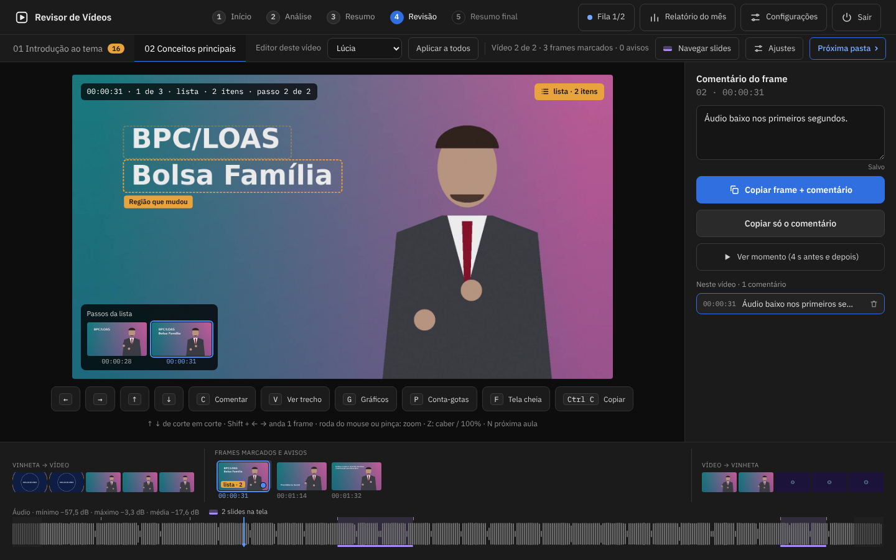

---

## 5. Tela de revisão: todas as funções

### Andar pelo vídeo

- **← →**: item anterior / próximo. Itens são os **frames marcados** (texto que entrou ou saiu,
  slide que mudou, listas) e todos os **avisos** (áudio, ortografia, tarja, transição de slide,
  vinheta, imagem congelada, falas).
- **↑ ↓**: corte anterior / próximo (os tracinhos no topo da forma de onda). Bom para dar uma olhada
  rápida em cada emenda. O frame mostra "corte 3 de 41".
- **Shift + ← →**: anda 1 frame.
- **Clique na forma de onda** (embaixo): vai para aquele ponto.
- **Clique numa miniatura** da tira "Frames marcados e avisos": vai para ela.
- **Próxima aula ›** (canto de cima, à direita) ou **N**: próximo vídeo. Na última aula vira
  **Próxima pasta** (fila) ou **Resumo final**.

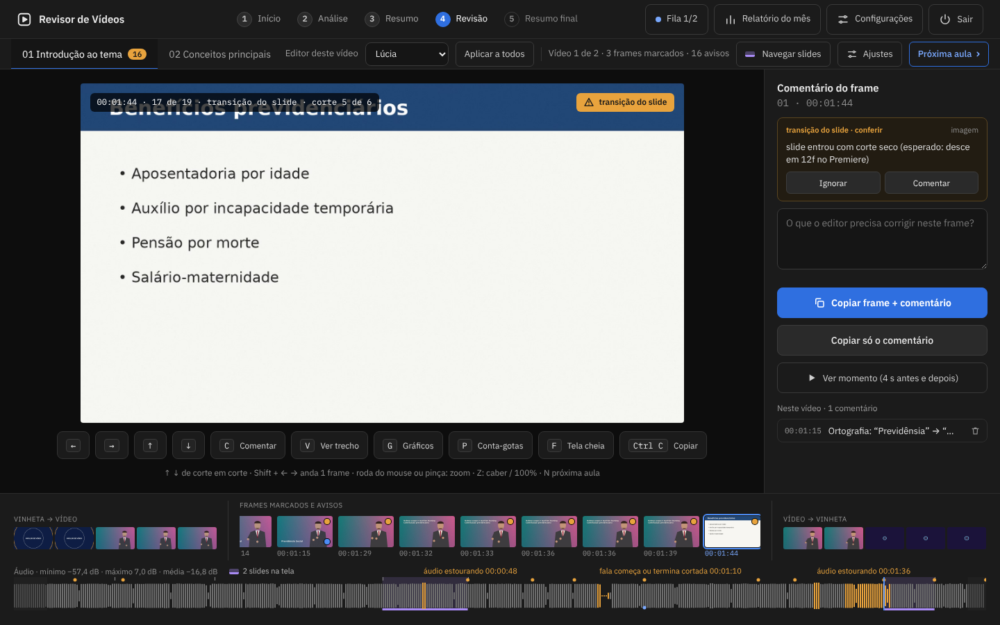

### Avisos e comentários

Quando o item é um aviso, aparece um cartão âmbar à direita:

- **Ignorar:** o aviso não conta mais neste vídeo (fica na lista, apagado, com "Desfazer").
- **Aceitar** (só ortografia): a palavra entra na sua lista e deixa de ser avisada em todas as aulas.
- **Comentar:** escreve o comentário pronto (ex.: *Ortografia: "Previdênsia" → "Previdência".*).

O comentário salva sozinho. Um comentário por frame; apagar o texto apaga o comentário. A lista
**Neste vídeo** mostra todos, com atalho para ir até cada um.

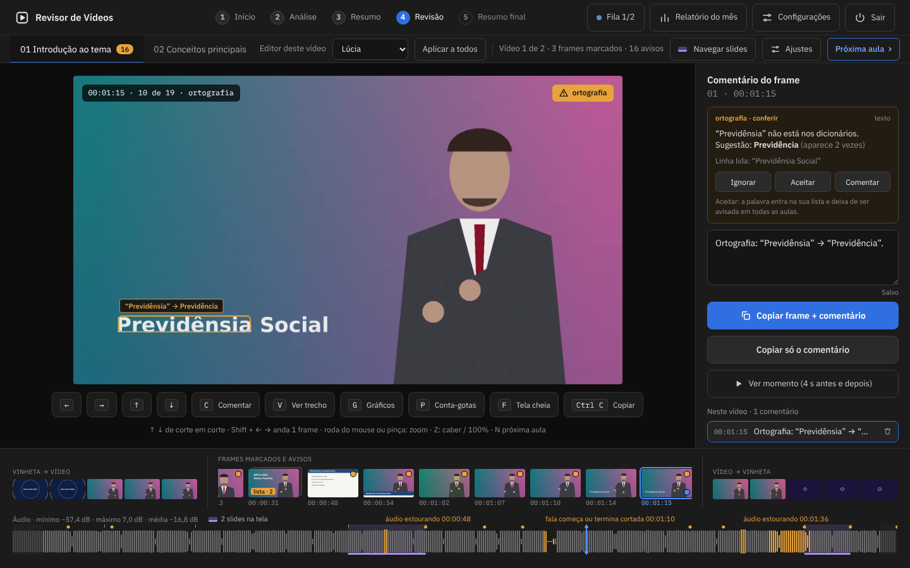

- **Copiar frame + comentário** (ou **⌘C** no Mac / **Ctrl+C** no Windows): copia a imagem do
  frame e o texto "Vídeo 01 · 00:01:15 · comentário". Cole no e-mail, no WhatsApp ou no Trello.
- **Copiar só o comentário:** só o texto.

### Ver o trecho (V) e o medidor de áudio

**V** (ou **Ver momento**) toca o trecho em volta do frame. Na caixa dentro do trecho, escolha
quanto tempo antes e depois: de 1 a 15 segundos (o app lembra a escolha). **Espaço** toca/pausa,
clicar na barra pula, **Esc** volta ao frame.

À direita do trecho, o **medidor de áudio** mostra o nível em tempo real, em dB (0 = o máximo digital):
- verde até −6 dB, âmbar de −6 a −1 dB, vermelho acima de −1 dB;
- **pico:** o valor mais alto do trecho;
- a luz **0 dB** acende se o áudio encostar no máximo (estourou).

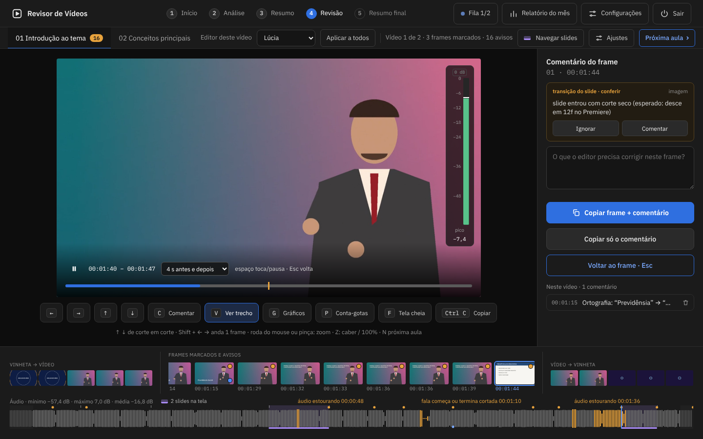

### Zoom

Roda do mouse, pinça no trackpad ou **+ −**. **Z** alterna entre "caber na tela" e 100% (1 pixel do
vídeo = 1 pixel da tela). Arraste para mover; o mini-mapa no canto mostra onde você está. O zoom
continua igual ao trocar de item, para comparar o mesmo texto entre frames.

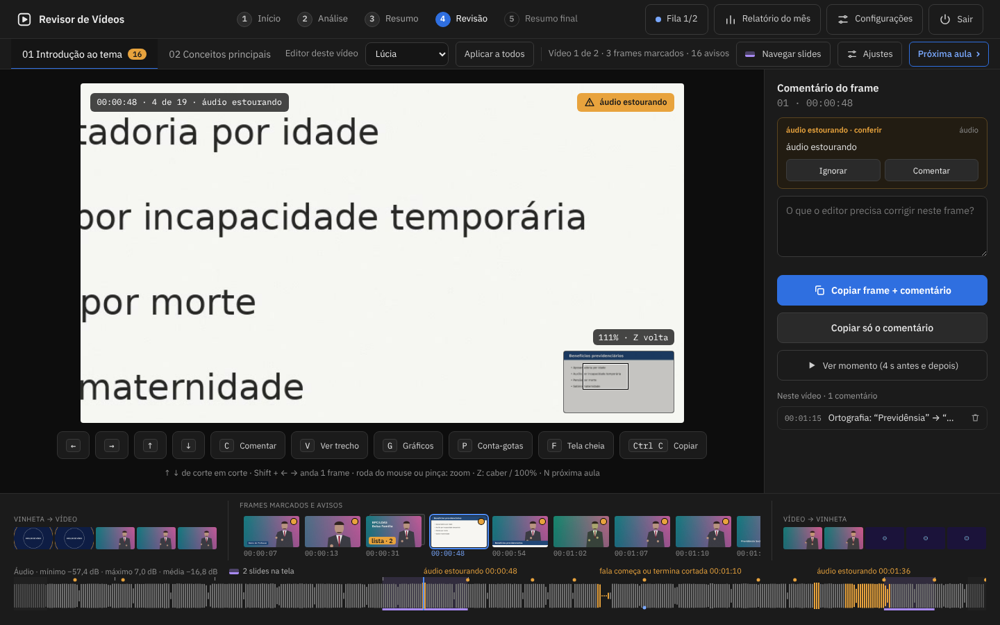

### Gráficos (G)

Waveform (luma ou parade RGB) e vectorscope **do frame**, lidos do vídeo original, com os alvos de cor
Rec.709 e a linha de tom de pele. Acompanham o frame ao andar com ← →.

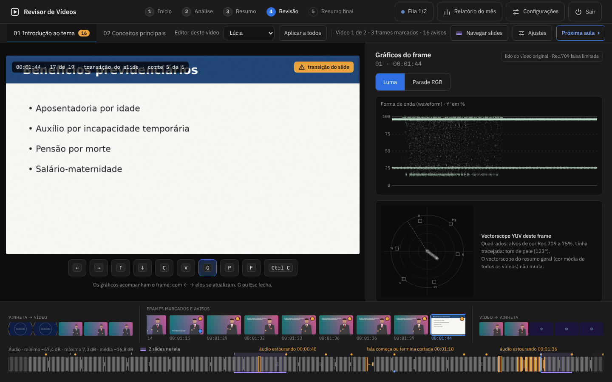

### Conta-gotas (P)

Passe o mouse sobre o vídeo: mostra brilho (Y′), Cb/Cr, RGB, ângulo e saturação de uma área de 9×9
pixels, e a distância até a linha de pele. **Clique** para fixar até 4 pontos; eles ficam no mesmo
lugar ao trocar de frame (para comparar). **Limpar pontos** tira todos.

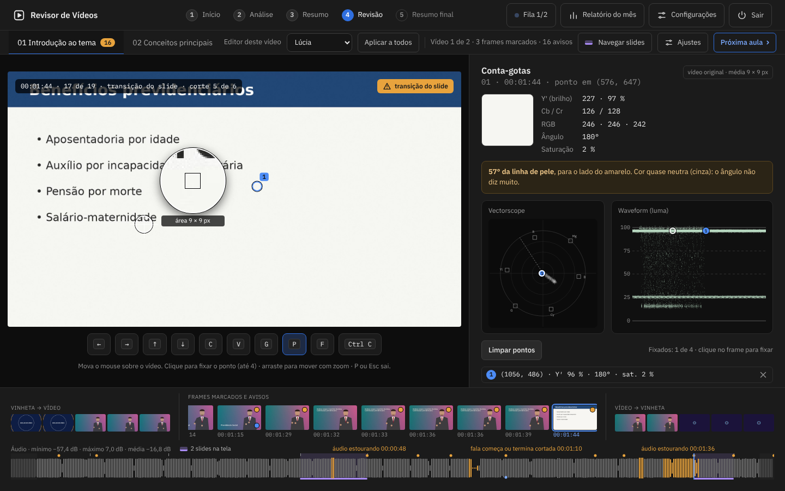

### Mais

- **F:** tela cheia do frame.
- **Navegar slides** (barra de cima): inclui cada slide em tela cheia na navegação com ← →, para
  conferir o texto de cada um. Liga/desliga para todas as revisões.
- **Ajustes** (barra de cima): sensibilidade da detecção e "juntar listas". Mudam na hora, sem
  analisar de novo.
- **Editor deste vídeo** (barra de cima): quem editou; **Aplicar a todos** marca todos os vídeos.
- **Rodapé:** os 5 frames da passagem vinheta → vídeo e vídeo → vinheta, a tira com todos os itens
  (ponto âmbar = aviso; ponto azul = comentado) e a forma de onda do áudio inteiro (faixa roxa =
  slide em tela cheia; trechos âmbar = aviso de áudio).

---

## 6. Resumo final: mandar as correções

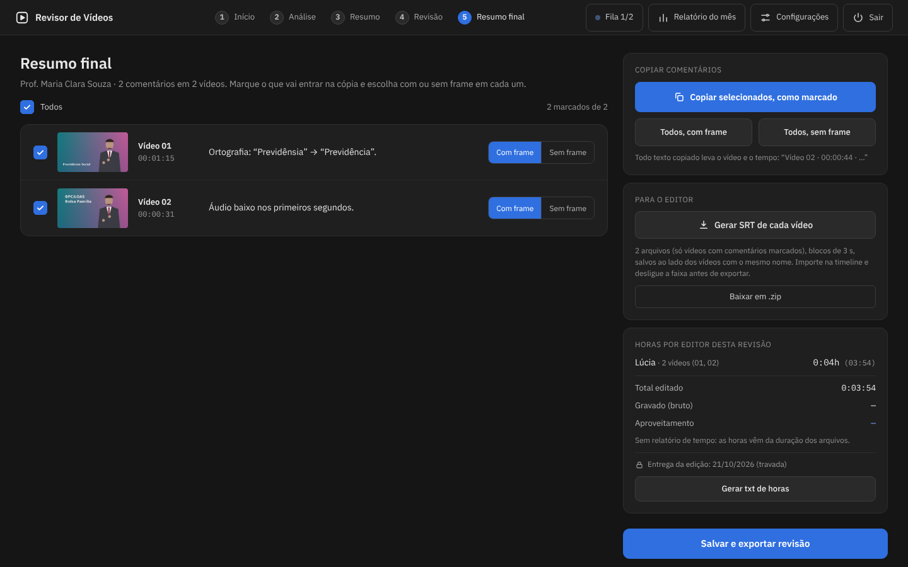

- Marque ou desmarque cada comentário e escolha **Com frame** ou **Sem frame** em cada um.
- **Copiar selecionados, como marcado** · **Todos, com frame** · **Todos, sem frame**: copia tudo
  de uma vez (texto + imagens) para colar no e-mail ou na conversa com o editor.
- **Gerar SRT de cada vídeo:** cria um `.srt` com o mesmo nome de cada vídeo comentado, com
  "CORRIGIR: comentário" no tempo certo. O editor importa na timeline do Premiere e vê as correções
  no lugar. (Os SRT ficam ao lado dos vídeos ou na subpasta "Correções", conforme as configurações.)
- **Horas por editor desta revisão** e **Gerar txt de horas**.
- **Salvar e exportar revisão:** veja a próxima seção.

---

## 7. Levar a revisão para outro computador

Em **Resumo final → Salvar e exportar revisão**:

- **Exportar pacote:** cria uma pasta com os comentários, as imagens dos frames comentados e as horas.
  Os vídeos não vão junto.
- No outro computador: **Início → Abrir revisão salva → Abrir pacote de outro computador**. O app
  reencontra os vídeos pelo nome e pela duração. Se a mesma revisão já existir lá, você escolhe:
  manter a deste computador, usar a do pacote ou juntar as duas.

---

## 8. Relatório do mês

Botão **Relatório do mês** no topo. Horas de vídeo editado por editor, por curso e por semana, com
o tempo gravado e o aproveitamento. O mês vem da **data de entrega da edição**, não do dia da revisão.
**Exportar txt** e **Exportar CSV** (abre no Excel).

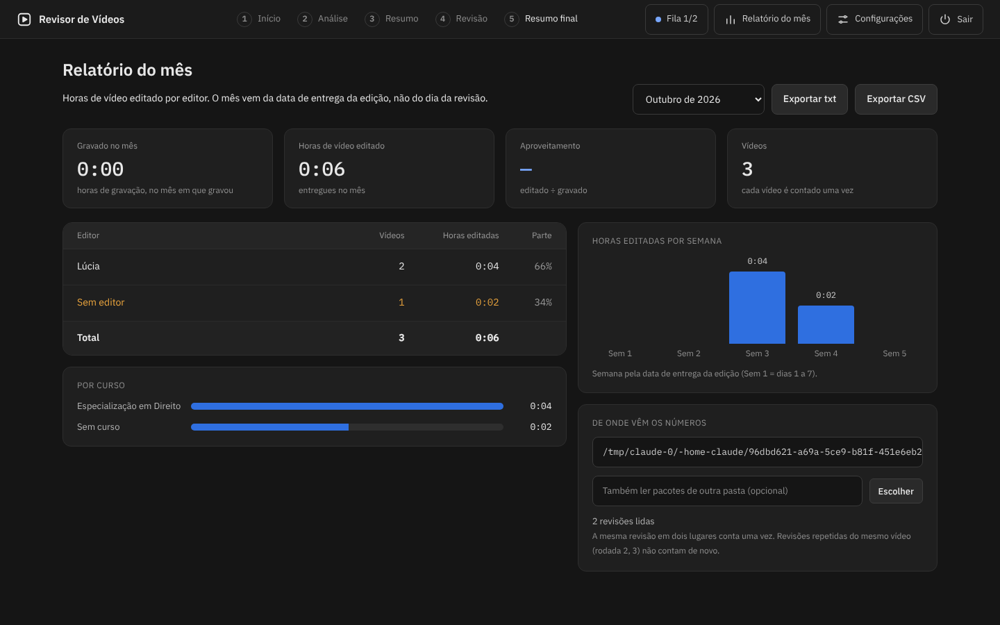

Para juntar revisões feitas em outros computadores, guarde os pacotes numa pasta (por exemplo, no
Google Drive) e indique essa pasta em **Configurações → Pastas**.

---

## 9. Configurações

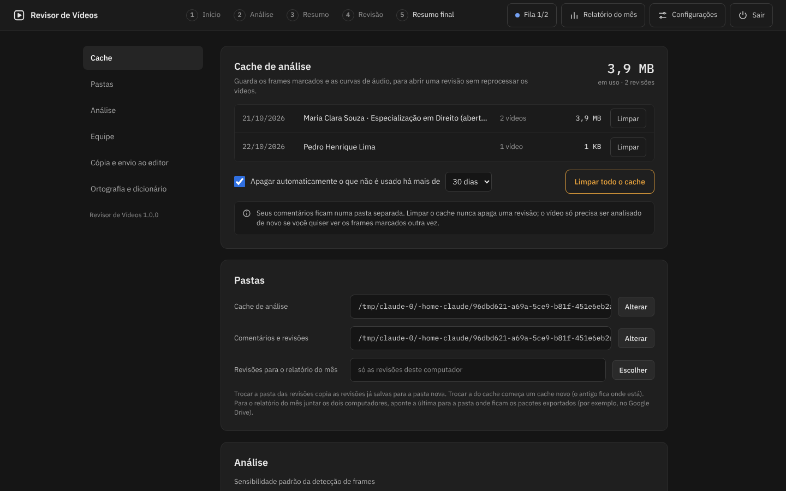

- **Cache:** quanto espaço as análises ocupam, limpar por revisão ou tudo, e a limpeza automática do
  que não é usado há N dias. Limpar o cache **nunca apaga revisões nem comentários**.
- **Pastas:** onde ficam o cache e as revisões salvas, e a pasta extra do relatório do mês.
- **Análise:** sensibilidade e "juntar listas" padrão, "Ouvir as falas" padrão, a lista de **frases
  de erro** ("errei", "retomando"…) e de **nomes genéricos da tarja** ("Nome do professor"…).
- **Equipe:** os editores (ver [seção 2](#cadastrar-a-equipe)).
- **Cópia e envio ao editor:** formato do tempo (segundos, ou timecode NDF/DF), duração de cada
  bloco do SRT, o texto do começo ("CORRIGIR:") e onde salvar os SRT.
- **Ortografia e dicionário:** inglês e latim liga/desliga, e a sua lista de palavras e expressões
  aceitas.
- No fim do menu da esquerda aparece a **versão** do app instalado.

---

## 10. Atalhos de teclado

Na tela de revisão:

| Tecla | O que faz |
|---|---|
| ← → | item anterior / próximo |
| ↑ ↓ | corte anterior / próximo |
| Shift + ← → | 1 frame para trás / para frente |
| N | próxima aula (na última: próxima pasta da fila) |
| C | escrever o comentário |
| V | ver o trecho (espaço toca/pausa) |
| G | gráficos do frame |
| P | conta-gotas |
| F | tela cheia |
| ⌘C (Mac) / Ctrl+C (Windows) | copiar frame + comentário |
| + − | zoom |
| Z | caber na tela / 100% |
| Esc | fecha o trecho, os gráficos ou o conta-gotas; sai do campo de texto |

---

## 11. Atualizar o app

1. Baixe de novo pelo link direto da [seção 1](#baixar-pelo-github) (ele sempre entrega a versão
   oficial mais nova).
2. Troque o app antigo pelo novo (Mac: arraste por cima; Windows: extraia por cima ou numa pasta nova).
3. **Mac:** repita o comando `xattr` do passo 3 da instalação (cada versão nova vem bloqueada de novo).

Configurações, equipe, cache e revisões ficam **fora** do app, então atualizar não apaga nada.
Para saber qual versão você tem: **Configurações**, no fim do menu da esquerda.

---

## 12. Problemas comuns

- **"O Revisor de Vídeos não está aberto"** na página: o app fechou (por exemplo, a aba ficou
  fechada por um tempo). Abra o app de novo com dois cliques.
- **O Mac diz que o app "está danificado" ou "não pode ser aberto":** faltou o comando `xattr` da
  instalação.
- **O trecho (V) não toca:** confira se o vídeo ainda está na pasta. O app tenta o vídeo original e,
  se o navegador não tocar, gera um trecho compatível (leva alguns segundos).
- **Nenhum editor para escolher:** cadastre a equipe em **Configurações → Equipe**.
- **Algo estranho aconteceu:** o arquivo `revisor.log` mostra o que o app fez. Ele fica em
  - Mac: `~/Library/Application Support/Revisor de Vídeos`
  - Windows: `%APPDATA%\Revisor de Vídeos`

Para conferir se tudo está dentro do app:
- Mac (Terminal): `~/Applications/"Revisor de Videos.app/Contents/MacOS/Revisor de Videos" diagnostico`
- Windows (Prompt de Comando, dentro da pasta do app): `revisor-terminal.exe diagnostico`
